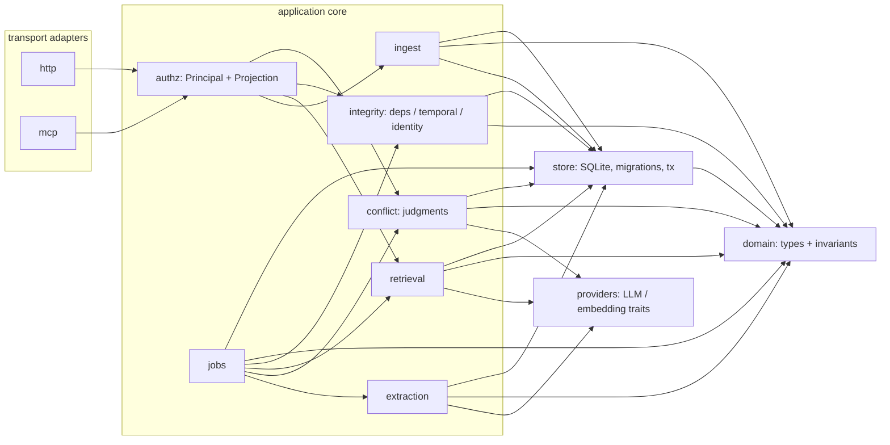
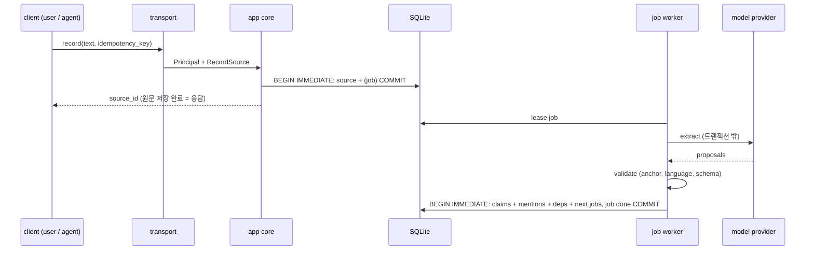
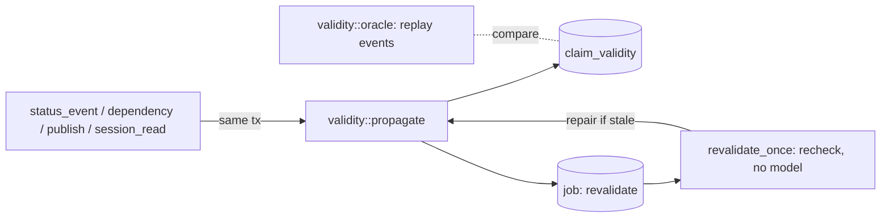

# Prime Radiant — ARCHITECTURE

Prime Radiant(구 Foundation)는 단일 사용자를 위한 장기 기억 백엔드다. 원문을 바꾸지 않고 보존하고, 원문에서 의미를 보존한 Claim을 파생하며, 출처·의존·시간·정체성·가시성을 분리해서 관리한다. 목적은 원 설계(`서고/Foundation.md`)와 같다: 사람의 장기 기억을 돕는 촉매이면서, 여러 에이전트가 공유하는 정확한 기억.

이 문서는 Phase 0 계약이다. 데이터 계약은 `DATA_CONTRACTS.md`, 결정 근거는 `DECISIONS.md`(D-번호), 구현 순서는 `IMPLEMENTATION_PLAN.md`, 첫 구현 단계는 `PHASE1_SPEC.md`.

## 1. 운영 가정

| 가정 | 결과 |
|---|---|
| 사용자는 한 명. 사용자 ID를 만들지 않는다 | `user`는 역할(principal kind)이지 식별자가 아니다 (D-04) |
| 로컬 머신 하나, 프로세스 하나가 DB를 소유 | 다중 프로세스 쓰기 미지원. stdio MCP는 같은 프로세스의 어댑터이거나 HTTP 클라이언트 (D-02) |
| SQLite 단일 파일, WAL | 기본 위치 `~/Library/Application Support/PrimeRadiant/prime_radiant.db`. iCloud 동기화 경로(`~/Library/Mobile Documents/…`)에서는 열기를 거부 (D-03) |
| 모델(추출·판정·임베딩)은 신뢰하지 않는 외부 제안자 | 모델 출력은 검증 경계를 통과해야만 저장되며, 원본 기록을 직접 바꾸지 못한다 (D-12) |
| UI 없음 | 사용자용 환경은 "사용자 투영(projection)"을 받는 클라이언트일 뿐이다 |

## 2. 구성

하나의 Rust 바이너리, 하나의 Tokio 런타임. 모듈은 처음에는 한 crate 안의 모듈로 두고, 경계가 컴파일 시간이나 의존성 격리에 실제 이득이 생길 때만 workspace crate로 나눈다.

### 모듈 책임

| 모듈 | 책임 | 하지 않는 것 |
|---|---|---|
| `domain` | ID, enum(Recorder, Speaker, Basis, Category, …), 값 검증(앵커 범위, UTF-8 경계), 상태 전이 규칙, 투영 규칙의 순수 함수 | I/O, SQL |
| `store` | 연결 관리(writer 1 + reader pool), PRAGMA, 마이그레이션, 트랜잭션 헬퍼, 무결성 검사, 백업/복원 | 정책 판단 (store는 domain이 허용한 쓰기만 수행) |
| `ingest` | Source 기록, 멱등 처리, (Phase 3부터) 추출 작업을 같은 트랜잭션에 등록 | 모델 호출 |
| `authz` | 인증된 `Principal` → 허용 연산 매트릭스, 사용자 투영 / 에이전트 뷰 생성 | 모델이 선언한 가시성 신뢰 |
| `extraction` | 작업 수행, 프롬프트·모델 버전 기록, 출력 검증(앵커 정확 일치, 언어, 필수 필드), Claim 기록 | 원문 수정, 번역 |
| `integrity` | 의존 그래프, 유효성 물질화(재귀 하향 폐포), 시간 질의, 정체성 단언/해소 | "거짓" 판정 |
| `retrieval` | 파생 인덱스(FTS bigram, 벡터, alias) 유지·재구축, 후보 생성, 게이트 결합, 투영 필터 | 고정된 순위 휴리스틱을 계약으로 노출 |
| `conflict` | 후보 쌍 구성, 모델 판정 기록, 사용자 확정/기각 | 자동 모순 단정, Claim 무효화 |
| `jobs` | 지속 작업 큐(임대, 재시도, 멱등 핸들러), 재시작 복구 | 정확히-한번 가정 |
| `providers` | `LlmProvider`, `EmbeddingProvider` trait, 모델별 입력 정책(예: DeepSeek 영어 전용 가드) | 도메인 로직 |
| `transport::{http,mcp}` | 인증 → `Principal`, 직렬화, 응용 코어 호출 | 독자적 권한 판단, 독자적 SQL |

### 의존 방향

`transport → authz → (ingest | retrieval | integrity | conflict) → domain, store`; `jobs → (extraction | conflict | retrieval | integrity)`; `extraction/conflict/retrieval → providers`. `domain`은 아무것도 의존하지 않는다. `store`는 `domain` 타입만 안다. 역방향 의존 금지. HTTP와 MCP는 같은 코어 함수(`App::…`)를 호출하며, 둘 사이에 다른 권한 경로가 생기면 그것은 버그다(D-05).

## 3. 쓰기 경로와 읽기 경로

- 원문 기록은 모델 없이 동기적으로 끝난다. 모델 장애는 기록을 막지 않는다.
- 모델 호출은 절대 트랜잭션 안에서 하지 않는다.
- 작업 결과 반영은 작업 ID로 멱등이다(같은 작업 재실행 = no-op).

읽기 경로: `transport → authz`가 Principal에 맞는 투영을 고르고, `retrieval`은 투영 집합 **안에서만** 후보를 만들고 점수·개수·요약·관계를 계산한다(투영 후 필터가 아니라 투영 내 계산, D-06).

## 4. 실패 모델

| 실패 | 기대 동작 |
|---|---|
| 프로세스 강제 종료(SIGKILL) | 커밋된 트랜잭션은 보존, 미커밋은 없음. 재시작 시 만료된 임대 작업 재획득 |
| 전원 손실 | `synchronous=FULL`(기본, D-03)로 커밋 내구성 확보. NORMAL은 측정 후 선택 가능 |
| 모델/임베딩 불가 | 기록은 성공, 작업은 backoff 재시도 후 `failed`로 남고 재시도 가능. 검색은 lexical 전용으로 강등하고 `degraded` 표시 |
| 모델 출력 이상(앵커 불일치, 다른 언어, 필드 누락) | 해당 제안 거부, 판정 기록에 사유 저장. 일부만 유효해도 원문 하나 단위로 전부 또는 전무(D-13) |
| 파생 인덱스 손상/불일치 | 권위 테이블에서 재구축. 권위 정보 손실 없음 |
| DB 손상 | `PRAGMA integrity_check` 실패 시 쓰기 거부, 백업에서 복원 |
| 같은 요청 중복/동시 | 멱등 키로 하나만 생성, 모두 같은 ID 반환 |
| 스키마가 바이너리보다 새로움 | 열기 거부(다운그레이드 실행 금지) |

## 5. 의도적으로 하지 않는 것

별도 서비스(벡터 DB, 그래프 DB, 큐 서버), PostgreSQL, 사용자 ID/멀티테넌시, 자동 모순 단정, 함의 확장 검색, 기본 번역, 신뢰도 숫자, 오래된 정보 자동 만료, 엔티티 자동 파괴적 병합, 22종 고정 노드 타입. 근거는 `DECISIONS.md`.

## 6. Phase 4 구현: `integrity` 모듈

| 파일 | 책임 |
|---|---|
| `integrity/mod.rs` | 대상 enum, 생애주기 SQL, user/agent Claim 술어, 의존 선언·조회, 통합 생애주기 명령, 파생 재구축·불일치 진단 |
| `integrity/validity.rs` | 3값 평가(2단계: 무효 → 불확실), 하향 폐포 증분 전파, 이벤트 로그 재생 오라클, 재구축 |
| `integrity/revalidation.rs` | `job(kind=revalidate)` 병합 예약, 임대·펜싱·멱등 완료, 워커 1단계(모델 호출 없음) |
| `integrity/provenance.rs` | `source_citation`, 에이전트 `session_read`, 투영 내 지지 계산 |
| `integrity/identity.rs` | `entity`/`identity_assertion`, 계층(user > agent > model) union-find, 파생 해소 테이블 |
| `integrity/temporal.rs` | `relation`, `model_judgment(task=temporal)`, R2 규칙 as_of, 신선도 정책 |

쓰기 경로: 권위 변경(생애주기 이벤트, 의존 삽입, 추출 게시, 세션 읽기)과 그 하향 폐포의 `claim_validity` 갱신, 필요한 재검증 job 예약이 **한 writer 트랜잭션**에서 커밋된다. 그래서 어떤 읽기 스냅숏도 커밋된 생애주기와 오래된 유효성을 함께 보지 않는다(동시 읽기 테스트). `App::open`은 파생 테이블을 권위 기록에서 복구한다. 읽기 경로: HTTP와 MCP는 같은 `Service::dispatch`를 거치며 세션은 `x-primeradiant-session` 헤더로만 전달된다(D-97). 투영 필터는 개수·커서·지지·관계·정체성 계산 **전에** 적용된다.

## 7. Phase 5 구현: `retrieval` 모듈
`record`는 인증·검증 후 한 트랜잭션에서 Source와 추출 job만 저장하고 영수증을 반환한다. 파생 작업(어휘 색인, 임베딩)은 승인 트랜잭션에서 큐에 들어가고 워커가 처리한다(`retrieval::queue`). 검색은 `planner`(결정적 계획) → `search`(exact/lexical → 필요 시 semantic → 제한된 graph/temporal 확장) → `fusion`(게이트 + RRF) → 권위 재확인 순서다. `access`는 인증 투영, `lexical`/`tokenizer`는 FTS5 기반 어휘 검색, `semantic`은 정확 코사인 스캔과 질의 임베딩 캐시, `status`는 단계·큐 관측이다. 임베딩 provider는 `embedding`(로컬 Nemotron-3-Embed-1B 기본, OpenRouter 선택, Off). 자세한 내용과 측정은 reports/retrieval.md.
