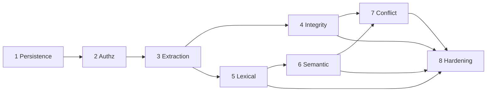

# Prime Radiant — IMPLEMENTATION_PLAN

각 Phase는 테스트 가능한 일관된 시스템을 남기고 Git 체크포인트(`phaseN: …` 커밋 + 태그 `phase-N`)로 끝난다. 시간 추정은 하지 않는다. 계약은 `DATA_CONTRACTS.md`, 근거는 `DECISIONS.md`.

P4와 P5는 P3 이후 병렬 가능(파일 겹침: `store` 마이그레이션 번호만 조정). P7은 정체성(P4)과 후보 생성(P6) 모두 필요.
공통 규칙: 테스트는 중요한 행동과 회귀만(사용자 지침). 모든 Phase는 `cargo test`가 네트워크 없이 통과해야 한다(모델은 fake provider).

---

## Phase 1 — Persistence Core
상세: `PHASE1_SPEC.md`.
1. 범위: crate 생성, `domain` 기본 타입, `store`(연결, PRAGMA, 마이그레이션, tx), `source` + `status_event`(source 대상 retract/forget/restore), 멱등 기록, 무결성 검사, 백업/복원, 내부 API(`App`)와 개발용 CLI.
2. 선행: 없음.
3. 산출물: 라이브러리 + `primeradiant` CLI(`init`, `record`, `get`, `check`, `backup`, `restore`, `migrate`).
4. 불변식: 원문 바이트 보존, source 불변, append-only 이벤트, recorder는 Principal에서만.
5. 테스트·6. 경계·7. 수락: PHASE1_SPEC §8.
8. 범위 밖: HTTP/MCP, 토큰 인증, Claim, 작업 큐, 모델, 인덱스.
9. 체크포인트: 수락 테스트 전부 녹색, `phase-1` 태그.

## Phase 2 — Authorship and Authorization
1. 범위: 로컬 자격증명(사용자 토큰 / 에이전트 토큰 / import 토큰, 파일 권한 0600) → `Principal`; 권한 매트릭스(DATA_CONTRACTS §4) 전체; user projection / agent view 함수(Source 수준); HTTP 어댑터(axum 등)와 stdio MCP 어댑터의 **최소 표면**(`record`, `get`, `list`, `retract`, `forget`) — 둘 다 같은 코어 호출.
2. 선행: P1.
3. 산출물: 인증된 HTTP/MCP 기록·조회, 투영 테스트 스위트.
4. 불변식: P-1~P-4; agent는 user source를 철회/망각 못함 [DB 트리거 + RS]; confirm은 user만.
5. 테스트: transport 동등성(같은 시나리오를 HTTP와 MCP로 실행해 같은 결과·같은 오류), 권한 매트릭스 표 기반 테스트, 누출 테스트(에이전트 기록 존재 여부가 user 투영의 개수·목록·오류 메시지·커서에 드러나지 않음), 토큰 없음/잘못된 토큰 거부.
6. 경계: 에이전트가 `speaker=user`/`user_requested`를 신고 → 여전히 agent; 토큰 파일 권한 과대 → 기동 거부; 같은 멱등 키를 user와 agent가 사용 → 별개 레코드.
7. 수락: 위 테스트 녹색, user projection이 Phase 2 R2 누출 검사 6종 중 Source 수준 해당 항목 통과.
8. 범위 밖: Claim 수준 투영(P3에서 확장), OAuth.
9. 체크포인트: `phase-2`.

## Phase 3 — Extraction Pipeline

완료: `phase-3` 체크포인트. v54 / Haiku 5.5의 우선 경계 6개·10개 Claim을 제한된 수정 흐름으로 검증했다(최초 3/6, 수정 후 6/6). 독립적인 전체 코퍼스 정답이나 보편적 모델 정확도를 뜻하지 않으며, 기본 프롬프트 자동 승격과 실제 Claim 승인은 하지 않았다. 상세: `reports/phase-3-semantic-acceptance.md`.

1. 범위: `job` 테이블과 워커(임대, backoff, 재시작 복구); 원문 기록 tx에 추출 job 포함 + 기존 source 백필 job; `LlmProvider` trait + fake provider + 실제 provider 1종; 추출 프롬프트(R2 frame 프롬프트 기반, 버전 해시); 검증 경계(DATA_CONTRACTS §5.1); `claim`, `mention`, 선언된 `claim_dependency` 저장(의미 적용은 P4); 재추출(`revision_of`); Claim 수준 user projection.
2. 선행: P2(Claim은 recorder·권한을 상속).
3. 산출물: 원문 → Claim 자동 생성, 실패 가시화.
4. 불변식: 원문 불변, 원문 언어 Claim, 앵커 정확 일치, 전부-또는-전무(D-13), 모델은 권위 기록 수정 불가, DeepSeek 영어 가드(D-24).
5. 테스트: fake provider로 — 정상 추출; 앵커 불일치/언어 불일치/필드 누락 거부; 작업 중 SIGKILL 후 재개 시 Claim 중복 없음; 임대 만료 재획득 멱등; provider 다운 시 기록 성공 + job 재시도 + 최종 failed; 재추출 시 이전 Claim 유지·`revision_of` 연결; 에이전트 축자 Claim이 user projection에 안 나옴. 고정 소규모 한/영 코퍼스에 대한 의미 보존 회귀(인용·부정·불확실·가정·시간 지시어) — 실제 모델 평가는 수동 실행 하네스로 분리.
6. 경계: 혼합 언어 원문, 이모지/결합 문자 경계 앵커, 빈 추출 결과(유효: "추출할 Claim 없음"), 매우 긴 원문(크기 상한 설정).
7. 수락: 위 테스트 + 하네스 1회 실행 결과를 `reports/`에 기록(점수는 계약 아님).
8. 범위 밖: 의존 의미·유효성, 엔티티 해소, 인덱스, 판정.
9. 체크포인트: `phase-3`.

## Phase 4 — Knowledge Integrity
1. 범위: 의존 의미(premise/restates/alternative/informed_by), 순환 검사, `claim_validity` 물질화 + 증분 갱신 + 오라클; `source_citation`; `session_read` + `deps_unknown`; 지지(원천 합집합); `entity`, `identity_assertion`, 해소(union-find), 병합/해제; 시간 필드 질의(as_of), temporal 판정 기록(`model_judgment task=temporal`)과 사용자/에이전트 `relation`(supersedes/exception/backfill); 재검증 job.
2. 선행: P3.
3. 산출물: 철회 → 전파 → 재검증이 작동하는 지식 그래프.
4. 불변식: 비순환, 거짓 표시 금지, 같은 원천은 독립 아님, 수동 정체성 교정 보존, 오래됨 ≠ 거짓.
5. 테스트: 무작위 그래프 + 무작위 철회/복원 시퀀스에서 증분 결과 = 오라클(속성 테스트 하나); 늦게 추가한 의존·과거 가져오기 순서에서도 동일; 순환 거부; alternative 하나 남으면 valid; source 철회 = 그 Claim 철회와 같은 결과; 잘못된 병합 → 해제 → 병합 기간 해소가 복원; 재추출 후 user 단언 유지; as_of 질의(R2 C 사례 몇 개 고정).
6. 경계: 자기 의존, 철회된 부모에 새 의존 추가(허용, 즉시 invalid), forget 후 restore.
7. 수락: 위 테스트 + 10만 Claim 합성 DB에서 철회 1건 증분 갱신 지연 측정 기록(목표 아님, 기준선).
8. 범위 밖: 검색, 충돌 판정.
9. 체크포인트: `phase-4`.

## Phase 5 — Lexical Retrieval
1. 범위: bigram 토크나이저(버전), `claim_fts`(+선택 `source_fts`), 재구축 명령, 엔티티 필터, 투영 안에서 계산되는 검색 API(HTTP/MCP), 에이전트 결과 메타데이터(validity, 원천 수, stale_hint).
2. 선행: P3 (엔티티 필터는 P4가 있으면 사용, 없으면 표면형 필터).
3. 산출물: 임베딩 없이 동작하는 완전한 검색.
4. 불변식: 인덱스는 파생, 재구축 후 권위 해시 불변, 누출 없음.
5. 테스트: 한국어 2글자 질의, 영어 식별자/코드 토큰, 재구축 동등성, 누출(점수·개수·커서), invalid/forgotten 제외.
6. 경계: 1글자 질의, 매우 긴 질의, 인덱스 손상 감지 → 재구축.
7. 수락: 위 + R3 B 하네스 동일언어 질의를 Rust로 재실행한 결과 기록.
8. 범위 밖: 임베딩, 결합.
9. 체크포인트: `phase-5`.

## Phase 6 — Semantic Retrieval
1. 범위: `EmbeddingProvider` trait(`model_id`, `dim`), bge-m3 기준선(로컬 ONNX 또는 원격 — 구현 시 선택, 결정 기록), `claim_vec`, 모델 id별 재임베딩 job, 브루트포스 코사인, 게이트 결합(임계값 설정), 강등 모드(`degraded: no_semantic_index`), 측정 하네스.
2. 선행: P5.
3. 산출물: 다국어 검색 + 측정 보고서.
4. 불변식: 원문 언어 텍스트 임베딩, 벡터는 파생, 모델 변경 시 혼합 사용 금지(질의와 같은 model_id 벡터만), 임베딩 장애가 기록·lexical 검색을 막지 않음.
5. 테스트: fake embedding으로 결합 게이트 동작, 모델 전환 중 혼합 금지, 장애 시 강등 표시, 재구축 동등성.
6. 경계: 차원 불일치 거부, 부분 임베딩 상태 검색.
7. 수락: R3 B 질의셋 + **새 300+ 항목 패러프레이즈 셋**에서 R@5, 교차언어 방향별 수치와 **e2e 지연(p50/p99)** 측정·기록. R@5 <0.9 방향이 있으면 D-20 재검토 메모 작성(블로커 아님, 기록 필수).
8. 범위 밖: ANN 인덱스(측정 근거 생길 때까지), 번역 행(off).
9. 체크포인트: `phase-6`.

## Phase 7 — Provisional Conflict Detection
1. 범위: 후보 생성(constraint-first 구성, K 설정), conflict 판정 job, `model_judgment` 기록, `possible_conflict` 투영(에이전트 전용), 사용자 확정/기각(`relation contradiction/not_conflicting`), 다중 판정 불일치 표시, 판정기 장애 시 큐잉.
2. 선행: P4, P6.
3. 산출물: 보수적 충돌 표시와 사용자 확인 흐름.
4. 불변식: 자동 contradiction 없음, 판정이 유효성·가시성·순위 불변, 모델은 relation 쓰기 불가 [DB 트리거], 판정 멱등.
5. 테스트: 판정이 어떤 라벨이든 relation 미생성; user만 contradiction; 판정 후 Claim invalid → 투영에서 빠짐; 같은 판정 재실행 no-op; 다른 모델 → 불일치 보존; user projection에 판정 누출 없음.
6. 경계: 같은 쌍 a/b 순서 정규화, 판정기 출력 파싱 실패 → 판정 없음 + job 실패 기록.
7. 수락: 위 + R3 C 68쌍을 Rust 파이프라인으로 재생(캐시 응답 사용)해 possible_conflict 수·정밀도(**엄격 정답 기준**과 허용 집합 기준 둘 다) 기록.
8. 범위 밖: 자동 해소, 자동 contradiction(C-frontier 결과와 무관하게 이번 Phase에서는 없음).
9. 체크포인트: `phase-7`.

## Phase 8 — Operational Hardening
1. 범위: HTTP/MCP 표면 완성(검색·관계·확정·정체성 교정), 동시성 부하 테스트, 장기 실행 복구, 백업 스케줄/보존, 성능 벤치(목표는 이 Phase에서 측정 후 확정), 관측(tracing), 선택: Foundation-MCP → Prime Radiant 가져오기(기존 Atom은 `recorder=import`, 원문 Source로, `usercreated`를 user로 승격하지 않음).
2. 선행: P4–P7.
3. 산출물: 일상 사용 가능한 로컬 서비스, 운영 문서.
4. 불변식: 전부.
5. 테스트: 장시간 혼합 부하 + 주기적 SIGKILL, 백업 중 쓰기, 복원 후 전체 불변식 검사, 가져오기 왕복(원문 바이트 일치).
6. 경계: 디스크 가득 참, DB 잠금 장기 보유 reader.
7. 수락: 측정된 목표 문서화 + 위 테스트 녹색.
8. 범위 밖: UI, 다중 사용자, 원격 동기화.
9. 체크포인트: `phase-8`, `v0.1.0`.
